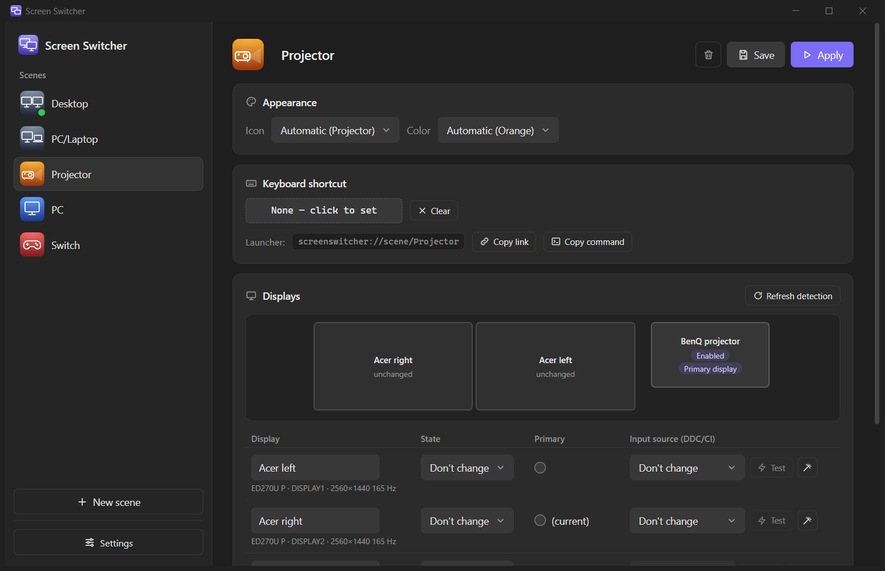
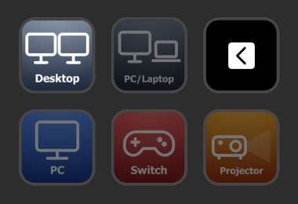
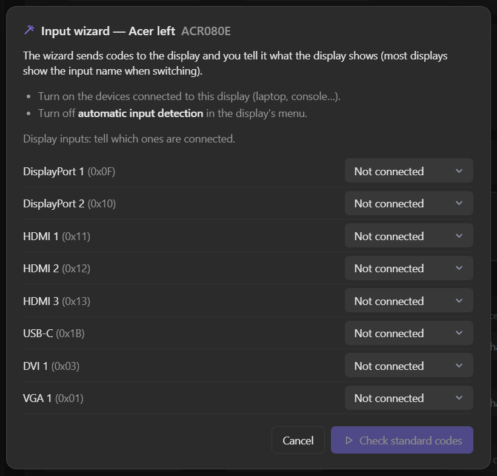

# Screen Switcher

A small Windows tool that applies display **scenes** from a keyboard shortcut, a click in the notification area, or an external launcher (programmable keypad, script…). Built for working from home: a personal PC and a work laptop sharing the same monitors, a projector, a console…

A scene can:

- **enable / disable a display** (e.g. turn off the projector's HDMI output); when re-enabled, resolution, refresh rate and position are restored;
- set the **primary display** (layout and refresh rates are kept);
- set the **default audio output**;
- switch the **input source of each monitor** (DisplayPort / HDMI…) over DDC/CI, to move your monitors from the PC to the laptop without touching their buttons.

Unneeded commands are skipped (display already primary, already on/off, input or audio already set).

The interface is in English or French, following the Windows language (can be changed in **Settings**).



<p align="center"></p>
<p align="center"><sub>Optional Stream Deck plugin: one key per scene, the active scene stands out.</sub></p>

## Installation

1. Download `Screen-Switcher-Setup-<version>.exe` from the [Releases](../../releases).
2. Run it. The installer is not signed: Windows SmartScreen shows “Windows protected your PC” → **More info** → **Run anyway**.
3. It installs for the current user (no admin rights) in `%LOCALAPPDATA%\Programs\screen-switcher`, without asking for a folder. Uninstall: Settings → Apps.

The app lives in the notification area (purple icon). Closing the window does not quit it; “Quit” is in the icon's menu. Check **“Start with Windows”** so shortcuts work as soon as you sign in.

**Requirements**: Windows 10/11, PowerShell 5.1 (built into Windows). On a **locked-down work PC** (AppLocker, PowerShell constrained mode), the app's engine may be blocked: install it on the personal PC the monitors are connected to instead.

## Getting started

1. **New scene**, give it a name.
2. **Keyboard shortcut**: click the field, then press the combination (e.g. Ctrl+Alt+F1).
3. **Displays**: for each display, choose whether to enable/disable it, make it primary, and its input source.
4. **Audio output** if needed, then **Apply** (saves and applies the scene).

**Appearance**: the scene's icon and color (guessed from its name by default), also used by the Stream Deck plugin.

Drag and drop in the list to reorder scenes.

## Monitor compatibility (input source)

Primary display, enabling/disabling and audio go through Windows and work with **every display**. Switching the **input source** depends on the monitor:

- **DDC/CI must be enabled** in the monitor's menu (OSD) — often on by default;
- laptop screens, TVs and projectors usually don't support it;
- some docks / hubs (notably **DisplayLink**) don't pass DDC/CI through; a direct DP/HDMI/USB-C cable to the PC works;
- turn off **automatic input detection** in the monitor's menu, otherwise it may switch back on its own as soon as a device wakes up;
- many monitors **don't use the standard codes** (see below).

### Finding your monitor's codes

<p align="center"></p>

**Wizard** (wand button next to “Test”): select the connected inputs and the one used by this PC; the wizard sends the standard codes and asks what the monitor shows (keys 1–9, Space = nothing changed, N = black screen, A = another input). If the standard codes don't work, it scans 0x01–0x1F, then vendor codes (0x90–0x92, 0xC0–0xC2, 0xD0–0xD2), then 0x20–0xFF as a last resort. The codes found are saved for that monitor model; “Copy report” lets you share them in an issue. Keep the window on a display other than the one being tested (the wizard offers to move it).

Manually: in a scene, pick an input in the list and click **Test**: the code is sent immediately. If the monitor doesn't switch to the right input, try other values, or “Other (hex code)…”. The PC stays in control even when the monitor shows another input: you can always come back with the code that leads to the PC.

Standard codes (MCCS): `0x0F` DisplayPort 1 · `0x10` DisplayPort 2 · `0x11` HDMI 1 · `0x12` HDMI 2 · `0x1B` USB-C · `0x03` DVI · `0x01` VGA. Inputs marked ✓ are the ones the monitor reports (list often incomplete or wrong).

A non-standard monitor whose codes you found can be added to `MODEL_PROFILES` in `src/profiles.js` (the model code, e.g. `ACR080E`, is shown under the display name). Feedback is welcome through issues.

**Acer ED270U P (ACR080E)**, tested: writing `0x11`/`0x12` → DisplayPort; `0x01`/`0x0F`/`0x10` → **HDMI 2** port; the **HDMI 1 port can't be reached with any code**. Connect the device to control (laptop) to HDMI 2.

## Launchers

Each scene can also be triggered without a keyboard shortcut, from any tool that can open a link or run a program (“Copy link” / “Copy command” buttons in the editor):

| Launcher type | Value |
|---|---|
| opens a link | `screenswitcher://scene/Projector` |
| runs a program | `"…\Screen Switcher.exe" --scene "Projector"` |

Programmable keys on a keyboard or mouse can also simply send the scene's keyboard shortcut.

The scene is found by name (case and accents ignored): renaming a scene breaks the keys that call it.

### Stream Deck plugin

`streamdeck/plugin/` contains an Elgato Stream Deck plugin (software 7.1+) with a **Scene** action:

- drop-down list of scenes (read live from the app's configuration); the key follows renames;
- generated key image with the scene's name, an icon guessed from the name (display, projector, laptop, console…) and a color, both customizable;
- keys of **inactive** scenes are dimmed (optional); this also follows scenes triggered from the keyboard;
- ⚠ on the key if the scene wasn't applied within 15 s (nothing when everything is fine).

The plugin is attached to each release (`.streamDeckPlugin` file, double-click to install).

```bash
cd streamdeck/plugin
npm install
npm run build      # builds into com.rrytter.screenswitcher.sdPlugin/bin
npm run link       # installs the plugin as a link to this folder (dev), then restart the Stream Deck software
npm run pack       # .streamDeckPlugin file to double-click, in dist/
npm run images     # regenerates the plugin PNGs from assets/*.svg
```

Static icons for the “Website” action are also in `streamdeck/icons/`.

## Development

```bash
npm install
npm start          # from source
npm run dist       # installer in dist/
npm run icons      # regenerates the app icons from assets/src/*.svg
```

| File | Role |
|---|---|
| `src/main.js` | main process: tray, global shortcuts, scenes, config, autostart, language |
| `src/native.js` | JSON-lines bridge to the persistent PowerShell helper |
| `src/profiles.js` | DDC codes of non-standard monitors (shared main / UI) |
| `src/i18n.js` | English / French translations (shared main / UI / plugin) |
| `src/scene-icons.js` | scene tiles (shared UI / plugin) |
| `native/helper.ps1` | stdin/stdout loop, compiles `Native.cs` once at startup |
| `native/Native.cs` | Windows interop: CCD API, `IPolicyConfig` audio, `dxva2` DDC/CI |
| `renderer/` | editor UI (HTML/CSS/JS, no framework); `wizard.js` = input wizard |

Configuration: `%APPDATA%\screen-switcher\config.json` (shared by the installed version and `npm start`). See `CLAUDE.md` for technical details and known pitfalls.

The dev version and the installed version both register the Start menu shortcut, the `screenswitcher://` link and the autostart entry: the last one launched wins. Keep only one for daily use.

## License

Copyright (C) 2026 Romain Rytter

This program is free software: you can redistribute it and/or modify it under the terms of the [GNU General Public License](LICENSE) as published by the Free Software Foundation, either version 3 of the License, or (at your option) any later version. It is distributed without any warranty.
